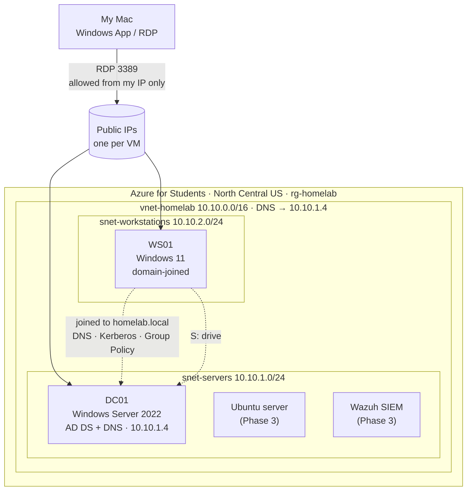
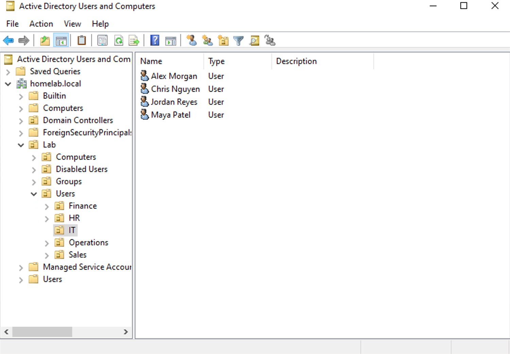
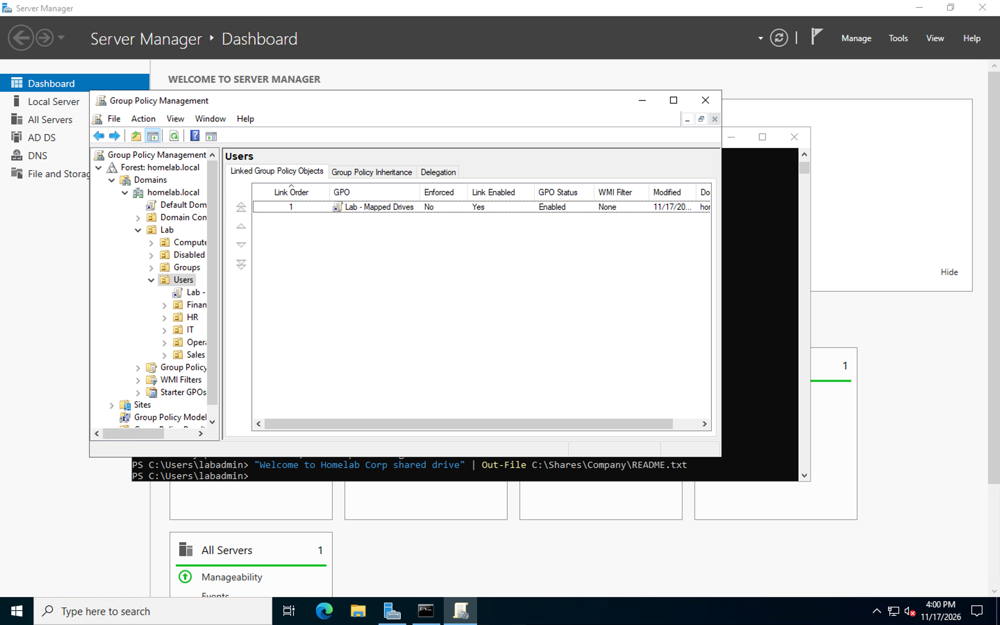
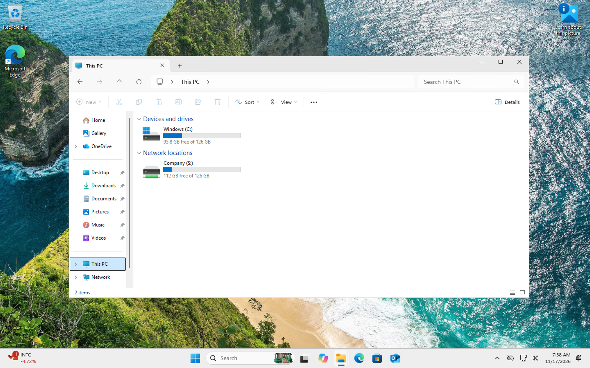

# Azure Homelab

A small company network built in Microsoft Azure: a Windows Server domain controller running Active Directory and DNS, domain-joined workstations, a Linux server and a SIEM watching all of it. I'm building it in phases to practice the day-to-day work of IT support, systems administration and security operations.

| Phase | What gets built | Status |
| --- | --- | --- |
| 1 | Network, cost controls, domain controller (AD DS + DNS) | ✅ Done |
| 2 | Users and OUs, Windows 11 workstation joined to the domain, Group Policy, help desk scenarios | ✅ Done |
| 3 | Ubuntu server, Wazuh SIEM on every VM, simulated attacks, incident reports | 🔜 Next |
| 4 | Whole lab as Terraform, automation scripts | Planned |

## Architecture



## Phase 1: Domain controller

**Goal:** a working Active Directory domain (`homelab.local`) in a private Azure network that only I can reach.

- Created a **$50 monthly budget** with alerts at 50% and 90%, plus **auto-shutdown at 11 PM** on every VM, so the $100 student credit lasts
- Built `vnet-homelab` (10.10.0.0/16) with separate **server** and **workstation** subnets
- Deployed **DC01** (Windows Server 2022, Standard_B2als_v2) with a **static private IP** (10.10.1.4)
- Locked the RDP rule in the network security group to **my IP address only**, instead of the whole internet
- Promoted DC01 to a **domain controller** for a new forest, `homelab.local`, with integrated DNS
- Added a DNS forwarder to Azure's resolver (168.63.129.16) and pointed the virtual network's DNS at DC01, so every future VM finds the domain automatically

| Server Manager: AD DS and DNS healthy | PowerShell: domain and DNS checks |
| --- | --- |
|  |  |

📘 Step-by-step guide: [docs/phase1-domain-controller.md](docs/phase1-domain-controller.md)
🛠️ What broke and how I fixed it: [docs/build-log.md](docs/build-log.md)

## Phase 2: Users, workstation, Group Policy and help desk

**Goal:** run the lab like a real company IT team: users and groups, a managed Windows PC, policies pushed from the server, and common help desk tickets.

- **Scripted the directory** with [`New-LabUsers.ps1`](scripts/phase2/New-LabUsers.ps1): a `Lab` OU tree (Users by department, Computers, Groups, Disabled Users), a security group per department plus `GG-Helpdesk`, and 20 users created from [a CSV](scripts/phase2/lab-users.csv). It has a `-WhatIf` dry run and a log, skips anything that exists, and never stores the password
- **Built WS01**, a Windows 11 workstation on the workstation subnet, and **joined it to `homelab.local`** straight into the `Workstations` OU with `Add-Computer`
- **Domain password policy:** 12+ characters, complexity on, and **lockout after 5 failed attempts for 15 minutes**
- **Group Policy:** created a `Company` file share on DC01 and a GPO, `Lab - Mapped Drives`, that maps it as **S:** for every user in the Users OU

| Active Directory OU structure | Group Policy linked to the Users OU |
| --- | --- |
|  |  |

| S: drive mapped automatically on WS01 |
| --- |
|  |

### Help desk tickets worked

| Ticket | What I did | Proof |
| --- | --- | --- |
| **Password reset:** Maya Patel can't sign in | Reset her password with `Set-ADAccountPassword` and confirmed she could log in to WS01. Remote Desktop's Network Level Authentication blocks accounts that must change their password before the session starts, so the reset clears that flag | sign-in as `HOMELAB\maya.patel` |
| **Account locked out:** Nina Lopez | Found her with `Search-ADAccount -LockedOut`, read **security event 4740** on DC01 for the lockout time and account, then ran `Unlock-ADAccount` | [screenshot](docs/screenshots/phase2-lockout-4740-investigation.png) |
| **Offboarding:** Tyler Ward left the company | Disabled the account, recorded the ticket in its description, removed group access and moved it to `Disabled Users`. Disabling instead of deleting keeps history for audits and rehire | [screenshot](docs/screenshots/phase2-offboarding-tyler-ward.png) |

📘 Step-by-step guide: [docs/phase2-users-workstation-gpo.md](docs/phase2-users-workstation-gpo.md)

## Skills practiced

- **Windows Server & Active Directory:** AD DS forest creation, DNS, OU design, security groups, bulk user provisioning with PowerShell, domain join, Group Policy (drive maps), domain password and lockout policy, SMB shares and NTFS permissions
- **Help desk:** password resets, account lockout investigation (event 4740) and unlock, offboarding
- **Azure:** virtual networks and subnets, network security groups, VM sizing, static IPs, Azure Policy, cost management
- **Security basics:** least-exposure RDP, budget guardrails, keeping secrets out of the repo
- **Troubleshooting:** reading Azure activity logs and policy assignments to find why deployments fail

## Cost

Everything runs on the free **Azure for Students** $100 credit. Each VM costs about $0.05 an hour while running and nothing compute-wise while stopped (deallocated), so a typical session costs cents.

## Repository layout

```text
docs/
  phase1-domain-controller.md   build guide for Phase 1
  phase2-users-workstation-gpo.md  build guide for Phase 2
  build-log.md                  problems hit and how they were solved
  screenshots/                  proof of each milestone
scripts/
  phase1/Install-DomainController.ps1
  phase2/New-LabUsers.ps1, lab-users.csv
```
