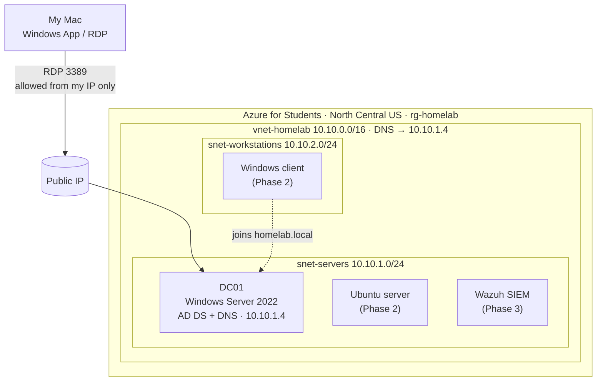
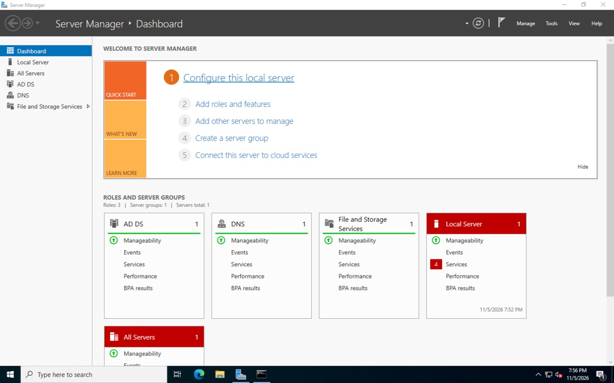
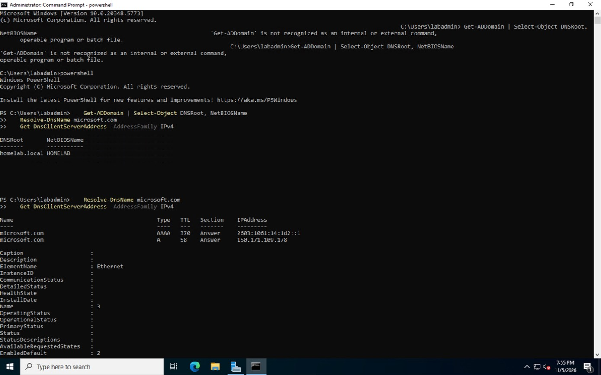

# Azure Homelab

A small company network built in Microsoft Azure: a Windows Server domain controller running Active Directory and DNS, domain-joined workstations, a Linux server and a SIEM watching all of it. I'm building it in phases to practice the day-to-day work of IT support, systems administration and security operations.

| Phase | What gets built | Status |
| --- | --- | --- |
| 1 | Network, cost controls, domain controller (AD DS + DNS) | ✅ Done |
| 2 | Users and OUs, Windows workstation joined to the domain, Group Policy, help desk scenarios, Ubuntu server | 🚧 In progress |
| 3 | Wazuh SIEM on every VM, simulated attacks, incident reports | Planned |
| 4 | Whole lab as Terraform, automation scripts | Planned |

## Architecture



## Phase 1: Domain controller

**Goal:** a working Active Directory domain (`homelab.local`) in a private Azure network that only I can reach.

- Created a **$50 monthly budget** with alerts at 50% and 90%, plus **auto-shutdown at 11 PM** on every VM, so the $100 student credit lasts
- Built `vnet-homelab` (10.10.0.0/16) with separate **server** and **workstation** subnets
- Deployed **DC01** (Windows Server 2022, Standard_B2als_v2) with a **static private IP** (10.10.1.4)
- Locked the RDP rule in the network security group to **my IP address only**, instead of the whole internet
- Promoted DC01 to a **domain controller** for a new forest, `homelab.local`, with integrated DNS
- Added a DNS forwarder to Azure's resolver (168.63.129.16) and pointed the virtual network's DNS at DC01, so every future VM finds the domain automatically

| Server Manager: AD DS and DNS healthy | PowerShell: domain and DNS checks |
| --- | --- |
|  |  |

📘 Step-by-step guide: [docs/phase1-domain-controller.md](docs/phase1-domain-controller.md)
🛠️ What broke and how I fixed it: [docs/build-log.md](docs/build-log.md)

## Phase 2: Users, workstation and Group Policy (in progress)

- ✅ Scripted the Active Directory structure with [`New-LabUsers.ps1`](scripts/phase2/New-LabUsers.ps1): a `Lab` OU tree (Users by department, Computers, Groups, Disabled Users), a security group per department plus `GG-Helpdesk`, and 20 users created from [a CSV](scripts/phase2/lab-users.csv). The script has a `-WhatIf` dry run, writes a log, skips anything that already exists, and forces a password change at first sign-in
- ⬜ Windows workstation joined to `homelab.local`
- ⬜ Group Policy: password policy, mapped drive, desktop settings
- ⬜ Help desk scenarios: password reset, account unlock, broken domain trust
- ⬜ Ubuntu server managed over SSH


## Skills practiced

- **Windows Server & Active Directory:** AD DS forest creation, DNS, domain controller networking, OU design, security groups, bulk user provisioning with PowerShell
- **Azure:** virtual networks and subnets, network security groups, VM sizing, static IPs, Azure Policy, cost management
- **Security basics:** least-exposure RDP, budget guardrails, keeping secrets out of the repo
- **Troubleshooting:** reading Azure activity logs and policy assignments to find why deployments fail

## Cost

Everything runs on the free **Azure for Students** $100 credit. The domain controller costs about $0.05 an hour while running and nothing compute-wise while stopped (deallocated), so a typical session costs cents.

## Repository layout

```text
docs/
  phase1-domain-controller.md   build guide for Phase 1
  build-log.md                  problems hit and how they were solved
  screenshots/                  proof of each milestone
scripts/
  phase1/Install-DomainController.ps1
```
