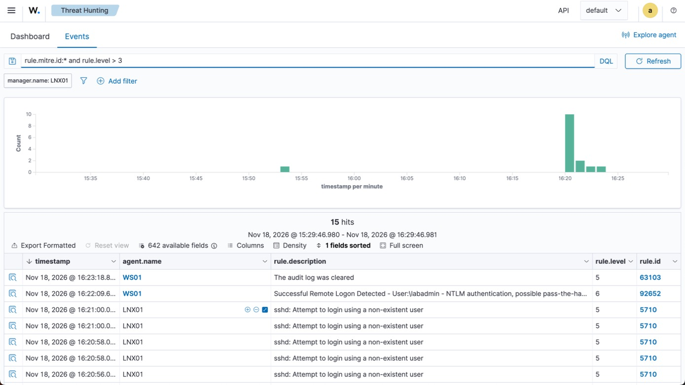
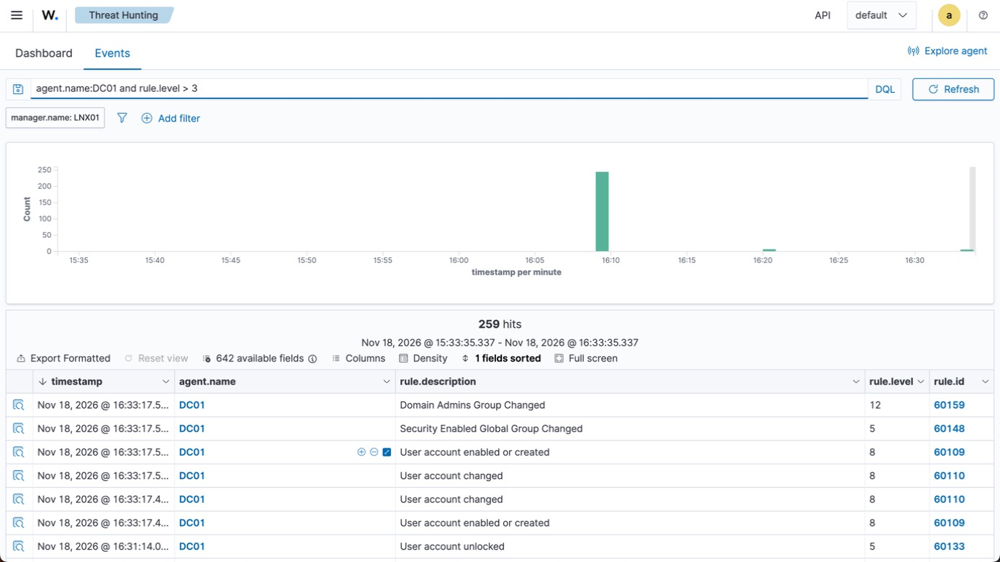

# Incident report: simulated multi-stage attack, 2026-11-18

**Type:** purple-team exercise (I played attacker and SOC analyst)
**Detection source:** Wazuh SIEM on LNX01, collecting Windows Security logs from DC01 and WS01 and auth logs from LNX01
**Window:** 16:10 to 16:35 EST

## Summary

Four attacker techniques were run against the `homelab.local` environment. Wazuh detected all four and mapped them to MITRE ATT&CK. One additional alert, a possible pass-the-hash logon, turned out to be a false positive caused by my own administrative RDP session.

## Timeline and detections

| Time (EST) | Host | Activity | Wazuh detection | MITRE ATT&CK |
| --- | --- | --- | --- | --- |
| ~16:10 | WS01 / DC01 | 8 failed RDP sign-ins as `nina.lopez` | Authentication failures on the Threat Hunting dashboard; the account locked out under the domain policy and needed an unlock | T1110.001 Password Guessing, T1531 Account Access Removal |
| 16:20–16:21 | LNX01 | SSH attempts as `admin`, `root`, `test` from an external IP | `sshd: Attempt to login using a non-existent user` (rule 5710), repeated | T1110 Brute Force, T1021.004 SSH |
| ~16:21 | DC01 | First attempt to create `svc_backup` | **Blocked:** the password didn't meet the 12-character complexity policy from Phase 2, so the account was never created | Prevention by policy |
| 16:31 | DC01 | Help desk unlocks `nina.lopez` | `User account unlocked` (rule 60133) | Recovery |
| 16:33 | DC01 | `svc_backup` created with a compliant password and added to **Domain Admins** | `User account enabled or created` (60109, level 8), `Security Enabled Global Group Changed` (60148), **`Domain Admins Group Changed` (60159, level 12)** | T1136.002 Create Domain Account, T1098 Account Manipulation |
| 16:23 | WS01 | Security event log cleared with `wevtutil cl Security` | `The audit log was cleared` (rule 63103) | T1070.001 Clear Windows Event Logs |
| 16:22 | WS01 | Admin RDP logon (`labadmin`) | `Successful Remote Logon Detected – NTLM authentication, possible pass-the-hash` (rule 92652) | **False positive**, see below |

| MITRE-mapped alerts (WS01, LNX01) | Backdoor admin on DC01 |
| --- | --- |
|  |  |

## Analysis

- **Brute force → lockout:** the domain lockout policy (5 attempts, 15 minutes) set in Phase 2 stopped the password guessing. The SIEM shows both the failures and the lockout, so the attempt is visible even though it failed.
- **SSH probing:** LNX01 only accepts SSH keys, so password guessing can't succeed. The NSG rule also limits port 22 to one IP. The alerts still show reconnaissance against common usernames.
- **Backdoor admin:** the most serious event, and Wazuh rated it highest (level 12). The first attempt failed because the domain password policy rejected the weak password, a small example of defense in depth. A new Domain Admin outside a change ticket should trigger immediate response.
- **Log clearing:** clearing WS01's local log didn't hide anything. The events had already been shipped to the SIEM, which is exactly why centralized logging matters.

### False positive: "possible pass-the-hash"

Rule 92652 fired on my own RDP sign-in to WS01 because it used NTLM network authentication, a pattern that pass-the-hash attacks also produce.

**Verification:** the source IP was my own (the only IP allowed through the NSG), the account was the known admin `labadmin`, and the logon matched my activity at that time.

**Tuning option:** add a local rule that lowers the level for NTLM logons by known admin accounts from the management IP, instead of disabling the rule entirely, so a real pass-the-hash from elsewhere still alerts.

## Response and recovery

| Action | Command |
| --- | --- |
| Removed backdoor account | `Remove-ADUser svc_backup -Confirm:$false` |
| Restored user access | `Unlock-ADAccount nina.lopez` |

## Lessons learned

1. Ship logs off the host. Attackers clear local logs; a SIEM keeps the evidence.
2. Account lockout and key-only SSH turn brute force from a breach risk into a noisy, visible failure.
3. Alert on privileged group changes (Domain Admins, Enterprise Admins) as high priority.
4. Every rule needs tuning: a SOC has to verify and adjust alerts like the NTLM one without hiding real attacks.
